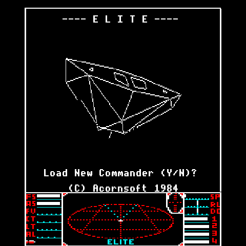
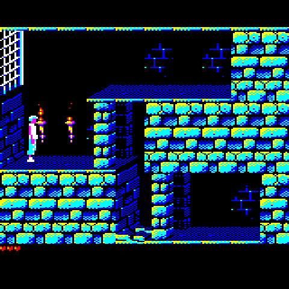
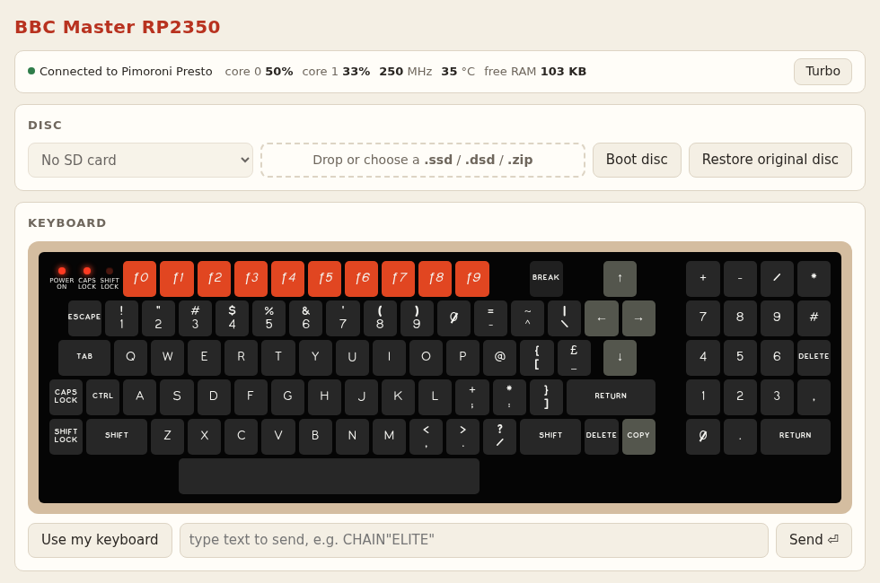

# BBC Micro on the RP2350


**The ultimate retro nerd desk toy.** A cycle-accurate **BBC Model B** or **BBC Master 128**, running on a
single $1.20 [Raspberry Pi RP2350](https://www.raspberrypi.com/products/rp2350/) chip in a
[Pimoroni Presto](https://shop.pimoroni.com/products/presto): a 480×480 touchscreen with WiFi and an SD
card slot. Power it on and it boots straight into Elite; from a phone, tablet or laptop you can load
other discs and type on the machine's own keyboard over WiFi.

- **Two machines, one build each:** the Model B on [beebjit](https://github.com/scarybeasts/beebjit)
  (Chris Evans' emulator, ported to the RP2350 with a new JIT), or the Master 128 on
  [Kieran Connell's](https://github.com/kieranhj) cycle-stepped emulator.
- **Real speed with room to spare:** Elite runs at the real machine's speed with each core mostly idle
  (Model B: 10% / 11%; Master: 44% / 33%).
- **Standalone:** no computer needed once it's flashed. Games save to the built-in disc and keep their
  saves through a power-off.
- **Extras:** the BBC's sound on the Presto's speaker, and the LEDs on its back lit with what's on screen.

| | | |
|---|---|---|
|  |  |  |
| Model B: Elite (flicker-free) | Master 128: Prince of Persia | Master 128: Stunt Car Racer |

## Quick start

You need a [Pimoroni Presto](https://shop.pimoroni.com/products/presto), a USB-C cable and a computer
with Git (Linux, macOS, or Windows with Git Bash).

```sh
git clone https://github.com/8bitkick/rp2350-bbc-micro.git && cd rp2350-bbc-micro
scripts/setup.sh              # BBC Model B  -> build/presto_beebjit.uf2
scripts/setup.sh --master     # BBC Master   -> build-master/presto_master.uf2
```

The Master boots Elite by default; `--master --disc=pop-beeb.ssd` builds in Prince of Persia instead
(also `bs-scr-beeb.ssd` Stunt Car Racer, `arcadians.ssd`, `bs-twisted.ssd`, `EvilIn11.ssd`, or your own).

`setup.sh` fetches everything it needs (the Arm toolchain, the Pico SDK, the machine's ROMs and Elite)
and builds the firmware. Add `--apt` on Debian, Ubuntu or Raspberry Pi OS to install the host packages
first. Sound and the LEDs are [build options](#build-options), off by default.

To flash it: hold **BOOT** on the Presto, tap **RESET**, and copy the `.uf2` onto the **RP2350** drive
that appears (or add `--flash` to `setup.sh`). It reboots into Elite.

Then put it on your WiFi, once, with the Presto plugged in over USB:

1. Copy [`tools/secrets.example.py`](tools/secrets.example.py) to `secrets.py` and fill in your network
   name and password (`secrets.py` is ignored by git).
2. Run `python3 tools/presto.py wifi secrets.py`. The Presto saves them in its flash and joins the
   network; it remembers them through power-offs and new firmware.
3. Open **[http://beeb.local/](http://beeb.local/)** in a browser on the same network.

## Web panel

| Model B | Master 128 |
|---|---|
|  |  |

- **Keyboard:** the machine's own, a Model B's or a Master 128's with its numeric keypad, with live
  CAPS LOCK and SHIFT LOCK lights; or type on your own keyboard, or send a line of text.
- **Discs:** drop in a `.ssd`, `.dsd` or `.zip` (or a link to one) to boot it, or pick one from the SD
  card. **Restore original disc** forgets what games saved to the built-in disc.
- **Sound:** with `-DSOUND=ON`, turn it on (it starts off) and set the volume.
- **Status:** each core's load, the clock, the chip temperature and free RAM; **Turbo** runs flat out.
- **Lights, program:** with `-DAMBIENT=ON`, the LEDs on the back; with a program built in alongside
  the machine (such as the [Elite agent](https://github.com/8bitkick/elite-agent)), its own panel.

## How it works

- **[docs/beebjit.md](docs/beebjit.md):** the Model B. Porting beebjit to the RP2350, its Thumb-2 JIT,
  how it was made about 9× faster than real time with an AI coding agent in the loop, and the test harness.
- **[docs/master/README.md](docs/master/README.md):** the Master 128. Kieran Connell's emulator on the
  Presto, the hardest Master games and demos measured, and why the Master isn't on beebjit.
- **[docs/cores.md](docs/cores.md):** which core does what on each machine, with the measured load.
- **[docs/porting-a-board.md](docs/porting-a-board.md):** adding another RP2350 board.

## Building from source

```sh
git clone https://github.com/8bitkick/rp2350-bbc-micro.git
cd rp2350-bbc-micro
scripts/setup.sh            # add --apt on Debian / Ubuntu / Raspberry Pi OS to install the host packages
```

On Windows, run it from Git Bash, with CMake and Ninja installed; it also fetches prebuilt
`pioasm` and `picotool`. To keep the toolchain and SDK (1.6 GB) somewhere else, such as outside a
synced folder, run `DEPS=<dir> scripts/setup.sh` once; `deps/env.sh` remembers it.

`setup.sh` fetches the Arm toolchain and the Pico SDK into `deps/`, downloads flicker-free Elite
(which isn't part of this repository), and builds `build/presto_beebjit.uf2`.
Flash it as in the [quick start](#quick-start), or run `scripts/setup.sh --flash` with the Presto in
BOOTSEL mode. To rebuild after a change: `. deps/env.sh && ninja -C build presto_beebjit`.

`scripts/setup.sh --gxr` also fetches Acorn's GXR graphics ROM, which many
[BBC Micro Bot](https://www.bbcmicrobot.com/) snapshots need.

### Build options

One machine and one board per build; everything else is a switch:

| Option | |
|---|---|
| `-DMACHINE=beeb` | The BBC Model B on beebjit (the default): `build/presto_beebjit.uf2` |
| `-DMACHINE=master` | The BBC Master 128 on Kieran Connell's emulator: `build/presto_master.uf2`. `scripts/setup.sh --master` fetches its MOS 3.20 ROMs and discs and builds it in `build-master/`; [docs/master/README.md](docs/master/README.md) has how it runs and why the Master isn't on beebjit |
| `-DBOARD=presto` | The board (the only one so far; [docs/porting-a-board.md](docs/porting-a-board.md)) |
| `-DSOUND=ON` | The BBC's sound on the Presto's piezo |
| `-DAMBIENT=ON` | The LEDs on the back lit with what's on screen |
| `-DAPP_SOURCES=...` | A program built in to run alongside the machine (`src/common/machine_hook.h`), with `-DAPP_INCLUDES`, `-DAPP_DEFINES` |
| `-DBEEB_DISC=<image>` | (Master) the disc built in; `-DPRESTO_BEEBJIT_DISC=<image>` for the Model B |

The first names still work: `-DPRESTO_MACHINE`, `-DPRESTO_BEEBJIT_SOUND`,
`-DPRESTO_BEEBJIT_AMBIENT`, `-DMACHINE_EXTRA_SOURCES` / `_INCLUDES` / `_DEFINES`.

```sh
. deps/env.sh
cmake -S . -B build-master -G Ninja -DMACHINE=master -DSOUND=ON && ninja -C build-master
```

### Source layout

| Directory | |
|---|---|
| `src/cores/beebjit/` | [beebjit](https://github.com/scarybeasts/beebjit), ported to the RP2350: the Thumb-2 JIT backend and memory and render changes, on upstream 2ff70a0 (listed in its `UPSTREAM`) |
| `src/cores/kc-beeb/` | Kieran Connell's Master 128 core, with a few small changes (its `UPSTREAM`) |
| `src/machines/beeb/`, `src/machines/master/` | Each machine's glue: a core on an RP2350; the Model B's harness tests |
| `src/common/` | Any RP2350 board: the command layer and the web page (`api/`), the USB channel, drive 0 and the save disc, the flash by region, the sound, the program hook, the board interface (`board.h`) |
| `src/boards/presto/` | The Presto: its panel, PSRAM, SD card, WiFi and web server, LEDs, flash layout |

[docs/cores.md](docs/cores.md) says which core does what on each machine, with the measured load.

## Tools

`tools/presto.py` speaks the firmware's command layer over USB: the same commands, by the same
names, as the web page's `/api/<name>`. `presto.py <name> [args]` gives the text reply,
`presto.py api <name> [args]` the JSON one (`presto.py api status`, as `GET /api/status`).

| Command | |
|---|---|
| `presto.py status` | The machine, board, speed, disc, saves, LEDs (as `/api/status`) |
| `presto.py restore` | The built-in disc as it came (what games saved to it forgotten) |
| `presto.py program` / `command <cmd>` | A program built in alongside the machine: its panel, a command |
| `presto.py audio` / `leds` | The sound's state (`-DSOUND`), the LEDs' (`-DAMBIENT`) |
| `presto.py shot out.png` | The framebuffer, read back as a PNG |
| `presto.py stats` | Per-core load and emulation speed |
| `presto.py raw turbo` | Run flat out |
| `presto.py raw lock` | Rows drawn after the panel's scan passed them |
| `presto.py key <sdl scancode> [ms]` | Press a BBC key |
| `presto.py state <snapshot.json>` | Load a BBC Micro Bot snapshot |
| `presto.py discs` / `disc <name>` / `put <file>` | The SD card's discs |
| `presto.py wifi secrets.py` / `net` | Save the WiFi network / show the link |
| `presto.py bootsel` | Reboot into the bootloader for flashing |

[AGENTS.md](AGENTS.md) has notes for developers and coding agents: how to
build and measure, where things are, and what hasn't been tried yet.

## Credits and licence

- **[beebjit](https://github.com/scarybeasts/beebjit):** Chris Evans.
- **[Graham Sanderson](https://github.com/kilograham/b-em/tree/pico):** the BBC Micro on the
  RP2040, which showed it could be done on a microcontroller at all.
- **[Kieran Connell](https://github.com/kieranhj):** for inspiring me to hack small devices again,
  and for the [BBC Master 128 emulator](https://github.com/kieranhj/esp32-beeb) in `src/cores/kc-beeb/` (GPL v3), the
  sound, the ambient LEDs, the Windows build and the disc-track cap.
- **[Andy Nightingale](https://github.com/andriodious):** the fix that lets the Presto save its WiFi
  details over USB ([#1](https://github.com/8bitkick/rp2350-bbc-micro/pull/1)).
- **ST7701 driver:** adapted from [Pimoroni's](https://github.com/pimoroni/presto) MIT-licensed driver.
- **[Flicker-free Elite](https://github.com/markmoxon/elite-source-code-bbc-micro-disc):** Mark
  Moxon. Elite is © Ian Bell and David Braben. `setup.sh` fetches it and builds it into the firmware;
  the source tree doesn't include it.
- **Screenshots:** Exile © Superior Software; Wobble Colours by Tom Seddon of [Bitshifters](https://bitshifters.github.io/).

beebjit is licensed under the GNU GPL v3, as is Kieran Connell's Master 128 emulator, and so is this port; see [COPYING](COPYING) and [LICENSE](LICENSE). The BBC Micro
ROMs in `roms/` are not covered by the GPL; see [roms/README.md](roms/README.md).
