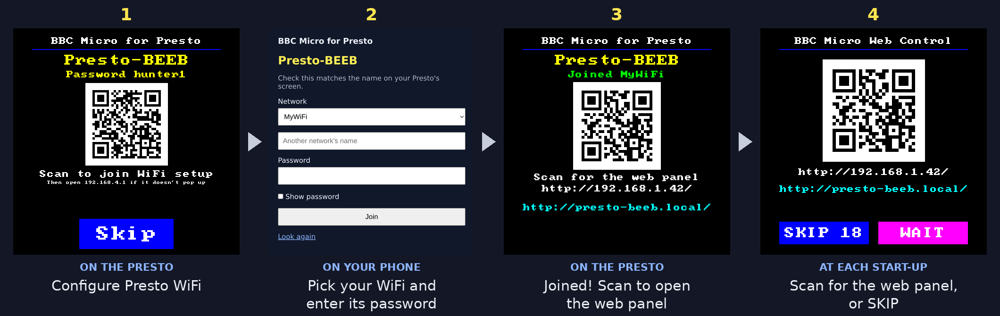

# BBC Micro on the RP2350


> [!TIP]
> Also for the Presto: [**rp2350-acorn-archimedes**](https://github.com/8bitkick/rp2350-acorn-archimedes),
> an Acorn Archimedes running RISC OS 3.11, with an ARM2 to Thumb-2 JIT: Archimedes Elite at full speed.

**The ultimate retro nerd desk toy.** A cycle-accurate **BBC Model B** or **BBC Master 128**, running on a
single $1.20 [Raspberry Pi RP2350](https://www.raspberrypi.com/products/rp2350/) chip in a
[Pimoroni Presto](https://shop.pimoroni.com/products/presto): a 480×480 touchscreen with WiFi and an SD
card slot. Power it on and it boots straight into Elite; from a phone, tablet or laptop you can load
other discs and type on the machine's own keyboard over WiFi.

- **Two machines, one build each:** the Model B on [beebjit](https://github.com/scarybeasts/beebjit)
  (Chris Evans' emulator, ported to the RP2350 with a new JIT), or the Master 128 on
  [Kieran Connell's](https://github.com/kieranhj) cycle-stepped emulator.
- **Real speed with room to spare:** Elite runs at the real machine's speed with each core mostly idle
  (Model B: 10% / 11%; Master: 44% / 33%).
- **Standalone:** no computer needed once it's flashed. Games save to the built-in disc and keep their
  saves through a power-off.
- **Extras:** the BBC's sound on the Presto's speaker, and the LEDs on its back lit with what's on screen.

| | | |
|---|---|---|
|  |  |  |
| Model B: Elite (flicker-free) | Master 128: Prince of Persia | Master 128: Stunt Car Racer |

## Quick start

No tools needed: one file onto the Presto.

1. Download `rp2350-bbc-micro-presto-<version>.uf2` from the [latest release](https://github.com/8bitkick/rp2350-bbc-micro/releases/latest).
2. Plug the Presto into your computer with a USB-C cable. Hold **BOOT** on the back, tap **RESET**, then let go:
   a drive called **RP2350** appears.
3. Drag the `.uf2` onto that drive. The Presto restarts by itself.

It boots the BBC Master 128 into [Mark Moxon's flicker-free Elite](https://elite.bbcelite.com/), and after a few
seconds [elite-agent](https://github.com/8bitkick/elite-agent) starts playing it as Commander JAMESON, already
Deadly, carrying on from its last save after a power-off. (Flashing a release replaces the Master's saves.) The BBC Model B, with its own
flicker-free Elite, is one click away on the [web panel](#web-panel---httppresto-xxxxlocal) once the Presto is on your
WiFi ([setting it up](#first-power-on-wifi) takes a phone and a minute). Elite is © Ian Bell and David Braben; the release carries Mark Moxon's builds unmodified, and this
repository doesn't contain them (`setup.sh` downloads them when you build).

### First power-on: WiFi



No WiFi wanted? Tap **Skip**. The web panel is at **http://presto-xxxx.local/**, the `xxxx` being on
the Presto's screen.

### More about WiFi

At power on the Presto shows a loading screen while it joins WiFi, then the web control panel's
address (its QR code, IP and `presto-xxxx.local`, the Presto's own name from the end of its board ID)
for 20 seconds (counting down on its **SKIP**; **WAIT** keeps it up until **OK**), and then starts the
BBC Micro, so it's seen booting from the start. To see the address again later, hold a finger still in
the top-left corner of the screen for 3 seconds.

If the saved network's password is wrong, the Presto goes straight into WiFi setup (below), saying so.
If the network isn't there or doesn't answer, it says so for a few seconds and starts without WiFi,
trying again every 15 seconds behind the machine.

If a phone doesn't open the setup page by itself, go to `http://192.168.4.1/`. The network is saved
only once the Presto has joined it. **Skip** (or ten minutes) carries on without WiFi until the next
restart. Setup runs before the BBC Micro starts, in memory the emulator isn't using yet (its
framebuffer), so it costs the machine nothing.

To set up WiFi again later: hold a finger on the screen while the Presto powers on, for about 2
seconds, or send `!wifisetup` over USB serial. The saved network stays until another is joined. A
network sent to `POST /api/wifi` is joined only once someone taps **Join** on the Presto's screen.
`tools/forget_wifi.py` makes a UF2 that forgets it. Or, over USB, without a phone:

1. Copy [`tools/secrets.example.py`](tools/secrets.example.py) to `secrets.py` and fill in your network
   name and password (`secrets.py` is ignored by git).
2. Run `python3 tools/presto.py wifi secrets.py`. The Presto saves them in its flash and restarts by
   itself. It remembers them through power-offs and new firmware.

`python3 tools/presto.py net` shows the link, its address and its name. Open
**http://presto-xxxx.local/** in a browser on the same network (or the address, if your network
doesn't do `.local` names).

## Web panel - http://presto-xxxx.local/

| Model B | Master 128 |
|---|---|
|  |  |

- **Keyboard:** the machine's own, a Model B's or a Master 128's with its numeric keypad, with live
  CAPS LOCK and SHIFT LOCK lights; or type on your own keyboard, or send a line of text.
- **Discs:** the disc in the drive on one line, with **Boot**. **Download game** offers ten classics from the
  [Stairway to Hell](https://www.stairwaytohell.com/) archive, or searches all 1,600 of its discs, as
  [jsbeeb](https://github.com/mattgodbolt/jsbeeb) does (your browser fetches them from the archive's
  mirror). Or drop in a `.ssd`, `.dsd` or `.zip` (or a link to one), or pick one from the SD card.
  (`python3 tools/presto.py restore` forgets what games saved to the built-in disc.)
- **Sound:** with `-DSOUND=ON`, turn it on (it starts off) and set the volume.
- **System:** **Turbo** runs flat out; **Sound** and its volume with `-DSOUND=ON`, **LEDs** (on the back) and
  their brightness with `-DAMBIENT=ON`.
- **Status:** each core's load, the clock and the chip temperature; ⚙ opens the [API](docs/api.md).
- **Plugin:** a plugin installed alongside the machine (such as the
  [Elite agent](https://github.com/8bitkick/elite-agent)): its state, its log and its own panel, or one
  line to install one.

## Architecture

The combined firmware (`scripts/build-dual-boot.sh`) holds both machines and an optional plugin in one
flash. At power on a small launcher boots the machine you chose last, and that machine runs the
plugin alongside it:

```
 Boot ROM
    │
    ▼
┌─ QSPI flash · 16 MB ─────────────────────────────────────────────────────────┐
│ 0x000000  launcher            reads the chosen machine, chains into its slot │
│ 0x008000  slot 0 · 4 MB       BBC Master 128: Kieran Connell's emulator      │
│ 0x408000  slot 1 · 4 MB       BBC Model B: beebjit with its Thumb-2 JIT      │
│ 0xE00000  slot 2 · 1 MB       the plugin, e.g. elite-agent (optional)        │
│ 0xF00000  shared              save discs, settings, WiFi network             │
└───────────────┬─────────────────────────────────────────┬────────────────────┘
                │ the chosen slot,                        │ the plugin, checked
                │ mapped to 0x10000000                    │ and run in place
                ▼                                         ▼
┌─ RP2350 · 2 × Cortex-M33 · 250 MHz ──────────────────────────────────────────┐
│ ┌─ Core 0 ────────────────────────────┐        ┌─ Core 1 ─────────────────┐  │
│ │ the BBC: CPU, VIAs, CRTC, disc      │ video  │ renderer: video into the │  │
│ │ paced to real time                  │ ─────► │ panel's rows             │  │
│ │ USB, web server, WiFi, SD card      │        │ sound, LEDs              │  │
│ │ the plugin's frame, between frames  │        │                          │  │
│ └─────────────────────────────────────┘        └──────────────────────────┘  │
│ SRAM 520 KB   the machine, the framebuffer; the plugin's RAM (Master)        │
│ PSRAM 8 MB    ROMs, sideways RAM, discs; the Model B's JIT code              │
└───────┬─────────────────────┬─────────────────┬─────────────────┬────────────┘
        ▼                     ▼                 ▼                 ▼
  480×480 panel         WiFi: web panel     USB serial         SD card
  (PIO + DMA)           (keys, discs, plugin)  (presto.py)        (discs)
```

- **The launcher** reads the chosen machine from the settings sector and has the boot ROM chain
  into that machine's slot. Each machine is a plain single-machine build, mapped to `0x10000000`
  as if it were alone in the flash. The panel's Machine switch saves a new choice and restarts.
- **The plugin** is an RP2350 program built on its own against `src/common/app_api.h`, and installed
  into slot 2 over WiFi or USB. Core 0 calls it between frames. It reads the BBC's RAM and presses
  its keys, and on the Master it gets as much SRAM as it needs, up to 72 KB (the rest goes to the heap). A plugin that hangs or faults twice in
  a row is turned off at the next boot. Core 0's stack is guarded by the M33's stack limit: a plugin
  that overflows it faults at once, the board restarts by itself and the plugin is turned off, saying why.
- **The shared area** sits outside every image, so the save discs, the WiFi network and the
  settings survive flashing any `.uf2`.

[docs/dual-boot.md](docs/dual-boot.md) has the details: the partition table, how it boots, the plugin's
header and rules, and how to get back from a bad flash.

## How it works

- **[docs/beebjit.md](docs/beebjit.md):** the Model B. Porting beebjit to the RP2350, its Thumb-2 JIT,
  how it was made about 9× faster than real time with an AI coding agent in the loop, and the test harness.
- **[docs/master/README.md](docs/master/README.md):** the Master 128. Kieran Connell's emulator on the
  Presto, the hardest Master games and demos measured, and why the Master isn't on beebjit.
- **[docs/api.md](docs/api.md):** the HTTP API behind the web panel, for your own scripts (the panel's ⚙
  opens it).
- **[docs/cores.md](docs/cores.md):** which core does what on each machine, with the measured load.
- **[docs/porting-a-board.md](docs/porting-a-board.md):** adding another RP2350 board.

## Building from source

```sh
git clone https://github.com/8bitkick/rp2350-bbc-micro.git
cd rp2350-bbc-micro
scripts/setup.sh            # add --apt on Debian / Ubuntu / Raspberry Pi OS to install the host packages
```

On Windows, run it from Git Bash, with CMake and Ninja installed; it also fetches prebuilt
`pioasm` and `picotool`. To keep the toolchain and SDK (1.6 GB) somewhere else, such as outside a
synced folder, run `DEPS=<dir> scripts/setup.sh` once; `deps/env.sh` remembers it.

`setup.sh` fetches the Arm toolchain and the Pico SDK into `deps/`, downloads the ROMs and
flicker-free Elite (which aren't part of this repository), and builds
`build-dual-boot/presto_dual_boot.uf2` (`--beeb`: `build/presto_beebjit.uf2`, `--master`:
`build-master/presto_master.uf2`). Flash it as in the [quick start](#quick-start), or run
`scripts/setup.sh --flash` with the Presto in BOOTSEL mode. To rebuild after a change:
`. deps/env.sh && scripts/build-dual-boot.sh` (one machine: `ninja -C build presto_beebjit` or
`ninja -C build-master`).

Or one machine on its own:

```sh
scripts/setup.sh --beeb       # BBC Model B  -> build/presto_beebjit.uf2
scripts/setup.sh --master     # BBC Master   -> build-master/presto_master.uf2
```

The Master boots Elite by default; `--master --disc=pop-beeb.ssd` builds in Prince of Persia instead
(also `bs-scr-beeb.ssd` Stunt Car Racer, `arcadians.ssd`, `bs-twisted.ssd`, `EvilIn11.ssd`, or your own).
On one machine's build, sound and the LEDs are [build options](#build-options), off by default.

`scripts/setup.sh --gxr` also fetches Acorn's GXR graphics ROM, which many
[BBC Micro Bot](https://www.bbcmicrobot.com/) snapshots need.

### Build options

One machine and one board per build; everything else is a switch:

| Option | |
|---|---|
| `-DMACHINE=beeb` | The BBC Model B on beebjit (the default): `build/presto_beebjit.uf2` |
| `-DMACHINE=master` | The BBC Master 128 on Kieran Connell's emulator: `build/presto_master.uf2`. `scripts/setup.sh --master` fetches its MOS 3.20 ROMs and discs and builds it in `build-master/`; [docs/master/README.md](docs/master/README.md) has how it runs and why the Master isn't on beebjit |
| `-DBOARD=presto` | The board (the only one so far; [docs/porting-a-board.md](docs/porting-a-board.md)) |
| `-DSOUND=ON` | The BBC's sound on the Presto's piezo |
| `-DAMBIENT=ON` | The LEDs on the back lit with what's on screen |
| `-DAPP_SOURCES=...` | A program built in to run alongside the machine (`src/common/machine_hook.h`), with `-DAPP_INCLUDES`, `-DAPP_DEFINES` |
| `-DBEEB_DISC=<image>` | (Master) the disc built in; `-DPRESTO_BEEBJIT_DISC=<image>` for the Model B |

The first names still work: `-DPRESTO_MACHINE`, `-DPRESTO_BEEBJIT_SOUND`,
`-DPRESTO_BEEBJIT_AMBIENT`, `-DMACHINE_EXTRA_SOURCES` / `_INCLUDES` / `_DEFINES`.

```sh
. deps/env.sh
cmake -S . -B build-master -G Ninja -DMACHINE=master -DSOUND=ON && ninja -C build-master
```

### Source layout

| Directory | |
|---|---|
| `src/cores/beebjit/` | [beebjit](https://github.com/scarybeasts/beebjit), ported to the RP2350: the Thumb-2 JIT backend and memory and render changes, on upstream 2ff70a0 (listed in its `UPSTREAM`) |
| `src/cores/kc-beeb/` | Kieran Connell's Master 128 core, with a few small changes (its `UPSTREAM`) |
| `src/machines/beeb/`, `src/machines/master/` | Each machine's glue: a core on an RP2350; the Model B's harness tests |
| `src/common/` | Any RP2350 board: the command layer and the web page (`api/`), the USB channel, drive 0 and the save disc, the flash by region, the sound, the program hook, the board interface (`board.h`) |
| `src/boards/presto/` | The Presto: its panel, PSRAM, SD card, WiFi and web server, LEDs, flash layout |

[docs/cores.md](docs/cores.md) says which core does what on each machine, with the measured load.

## Tools

`tools/presto.py` speaks the firmware's command layer over USB: the same commands, by the same
names, as the web page's `/api/<name>`. `presto.py <name> [args]` gives the text reply,
`presto.py api <name> [args]` the JSON one (`presto.py api status`, as `GET /api/status`).

| Command | |
|---|---|
| `presto.py status` | The machine, board, speed, disc, saves, LEDs (as `/api/status`) |
| `presto.py restore` | The built-in disc as it came (what games saved to it forgotten) |
| `presto.py program` / `command <cmd>` | A program built in alongside the machine: its panel, a command |
| `presto.py audio` / `leds` | The sound's state (`-DSOUND`), the LEDs' (`-DAMBIENT`) |
| `presto.py shot out.png` | The framebuffer, read back as a PNG |
| `presto.py stats` | Per-core load and emulation speed |
| `presto.py raw turbo` | Run flat out |
| `presto.py raw lock` | Rows drawn after the panel's scan passed them |
| `presto.py key <sdl scancode> [ms]` | Press a BBC key |
| `presto.py state <snapshot.json>` | Load a BBC Micro Bot snapshot |
| `presto.py discs` / `disc <name>` / `put <file>` | The SD card's discs |
| `presto.py wifi secrets.py` / `net` | Save the WiFi network / show the link |
| `tools/forget_wifi.py out.uf2` | A UF2 that blanks the saved WiFi network (and the setup network's password): flashed, the Presto starts in WiFi setup |
| `presto.py bootsel` | Reboot into the bootloader for flashing |

[AGENTS.md](AGENTS.md) has notes for developers and coding agents: how to
build and measure, where things are, and what hasn't been tried yet.

## Credits and licence

- **[beebjit](https://github.com/scarybeasts/beebjit):** Chris Evans.
- **[Graham Sanderson](https://github.com/kilograham/b-em/tree/pico):** the BBC Micro on the
  RP2040, which showed it could be done on a microcontroller at all.
- **[Kieran Connell](https://github.com/kieranhj):** for inspiring me to hack small devices again,
  and for the [BBC Master 128 emulator](https://github.com/kieranhj/esp32-beeb) in `src/cores/kc-beeb/` (GPL v3), the
  sound, the ambient LEDs, the Windows build and the disc-track cap.
- **[Andy Nightingale](https://github.com/andriodious):** the fix that lets the Presto save its WiFi
  details over USB ([#1](https://github.com/8bitkick/rp2350-bbc-micro/pull/1)).
- **ST7701 driver:** adapted from [Pimoroni's](https://github.com/pimoroni/presto) MIT-licensed driver.
- **[Flicker-free Elite](https://github.com/markmoxon/elite-source-code-bbc-micro-disc):** Mark
  Moxon. Elite is © Ian Bell and David Braben. `setup.sh` fetches it and builds it into the firmware;
  the source tree doesn't include it.
- **WiFi setup:** the DHCP server (Damien P. George, from MicroPython; MIT) and the DNS server
  (Raspberry Pi; BSD-3-Clause) from Raspberry Pi's pico-examples, Project Nayuki's
  [QR Code generator](https://www.nayuki.io/page/qr-code-generator-library) (MIT), and Daniel
  Hepper's [font8x8](https://github.com/dhepper/font8x8) (public domain), each with its notice in
  `src/boards/presto/lib/`; the setup flow is the one on the
  [Acorn Archimedes for the Presto](https://github.com/8bitkick/rp2350-acorn-archimedes).
- **Loading screen:** the 8bitkick logo, with the mark set in [Comfortaa](https://fonts.google.com/specimen/Comfortaa)
  (Johan Aakerlund, OFL), baked by `tools/make_splash.py` (from [elite-agent](https://github.com/8bitkick/elite-agent))
  into `src/common/splash/splash_default.c`; a plugin's own picture replaces it.
- **Screenshots:** Exile © Superior Software; Wobble Colours by Tom Seddon of [Bitshifters](https://bitshifters.github.io/).

beebjit is licensed under the GNU GPL v3, as is Kieran Connell's Master 128 emulator, and so is this port; see [COPYING](COPYING) and [LICENSE](LICENSE). The BBC Micro
ROMs in `roms/` are not covered by the GPL; see [roms/README.md](roms/README.md). In
`src/boards/presto/lib/`: `dhcpserver` and `qrcodegen` are MIT, `dnsserver` is BSD-3-Clause,
`font8x8_basic.h` is public domain, each with its notice.
