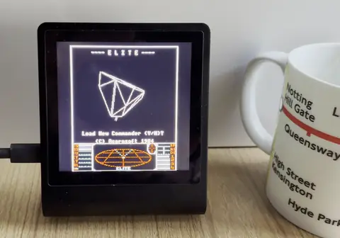
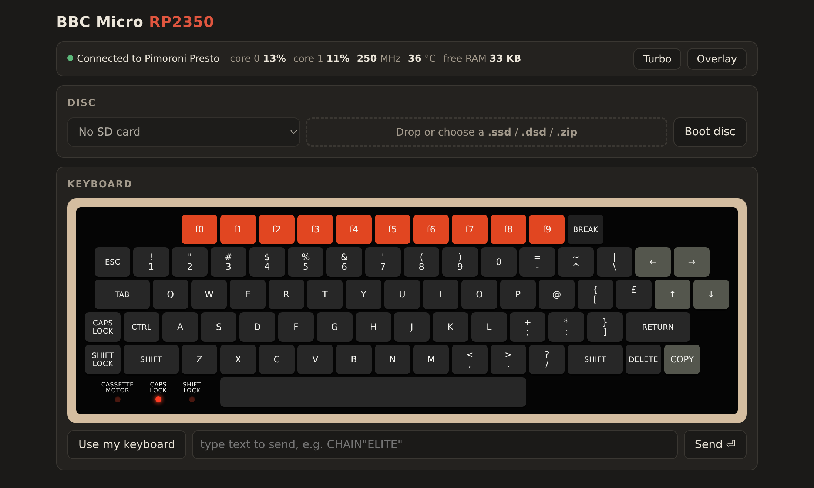
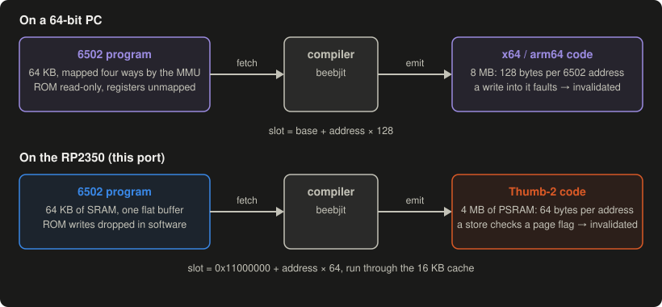
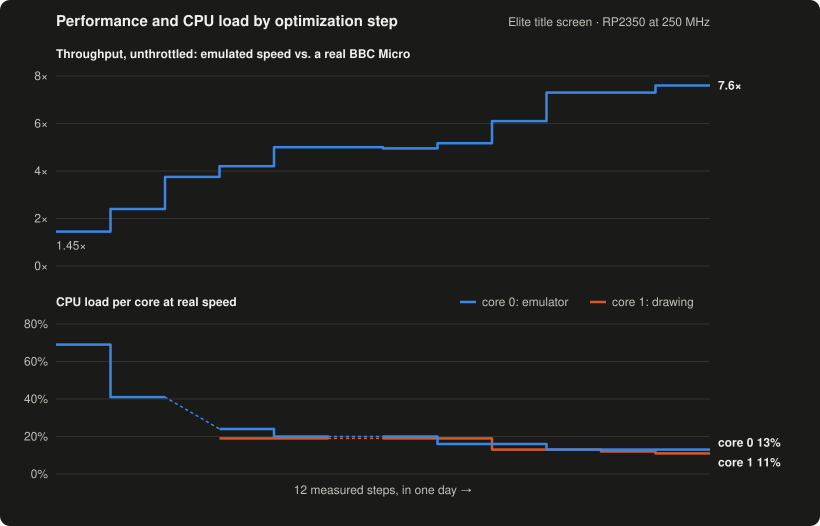
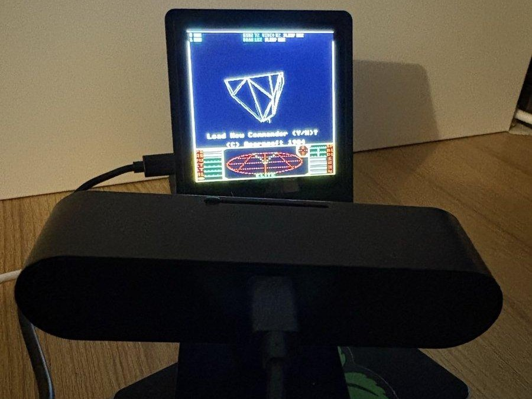
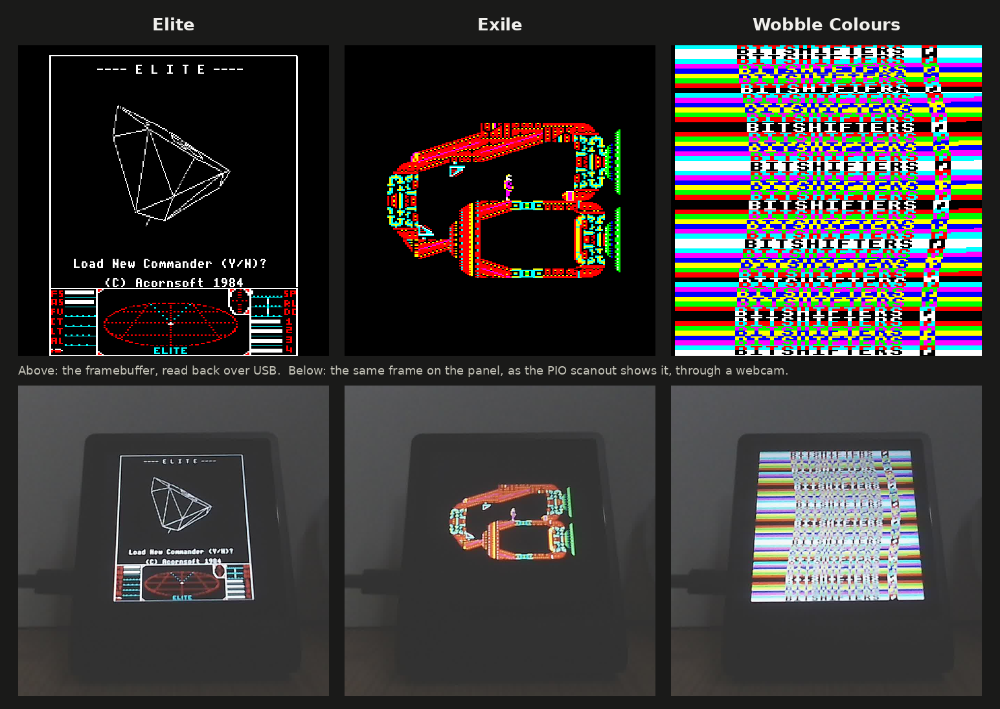

# BBC Micro on the RP2350



**The ultimate retro nerd desk toy.** A playable, cycle-accurate BBC Micro
emulation, all running on a single $1.20 [Raspberry Pi RP2350](https://www.raspberrypi.com/products/rp2350/) chip, in a
[Pimoroni Presto](https://shop.pimoroni.com/products/presto): a 480×480 touchscreen with WiFi and an SD
card slot. It runs [beebjit](https://github.com/scarybeasts/beebjit), Chris Evans' BBC Micro emulator,
ported to the RP2350 with a new JIT for its Cortex-M33 cores. It boots straight into
[flicker-free Acornsoft Elite](https://github.com/markmoxon/elite-source-code-bbc-micro-disc/tree/flicker-free),
and from a phone, tablet or laptop you can load other discs and type on a BBC keyboard over WiFi.

- **Accurate:** beebjit emulates the BBC's 6502 and hardware cycle by cycle; it's the emulator the
  [BBC Micro Bot](https://www.bbcmicrobot.com/) ran on from 2020.
- **Fast:** 7.6× real speed flat out on Elite; at real speed, core 0 is busy 13% of the time and
  core 1 11%.
- **Playable:** on-screen touch controls, or Pimoroni's optional
  [Qw/ST Pad](https://shop.pimoroni.com/products/qwst-pad) game controller plugged into the Presto's
  Qw/ST connector, with its buttons mapped to BBC keys (not built yet).
- **Standalone:** no computer needed once it's flashed.

## Quick start

1. Get a [Pimoroni Presto](https://shop.pimoroni.com/products/presto).
2. Download `presto_beebjit.uf2` from the
   [releases](https://github.com/8bitkick/rp2350-bbc-micro/releases), or build it (below).
3. Hold BOOT and tap RESET on the Presto, and drag the file onto the RP2350 drive that appears. It
   flashes itself, reboots and starts Elite.

## Web panel

Once the Presto is on your WiFi, open **[http://beeb.local/](http://beeb.local/)**:

- **Keyboard:** a BBC Micro keyboard with live CAPS LOCK, SHIFT LOCK and cassette motor LEDs, or
  your own keyboard by key position.
- **Discs:** drop in a `.ssd`, `.dsd` or `.zip` (or a link to one) to boot it, or pick one from the
  SD card.
- **Status:** each core's load, the emulation speed, the clock and the chip temperature; turbo.



To give it your WiFi network: `python3 tools/presto.py wifi secrets.py` over USB, with a
Pimoroni-style `secrets.py` containing `WIFI_SSID` and `WIFI_PASSWORD`.

## Development

I have spent many years doing retro projects by hand, and enjoying every moment of it.
I also have incredible respect for those who hone artisanal bits to squeeze performance out of a
machine (see my [BBC Micro Bot](https://www.bbcmicrobot.com/)). But more recently, I just haven't
had time. Having an idea and implementing, optimizing and sharing it in one day is incredible. The
key is a clear goal and a feedback loop for the AI coding agent. There were occasions I needed to
steer or correct it, but these tools keep getting better.

### The port

I bought a Pimoroni Presto from the [Raspberry Pi Store in
Cambridge](https://www.raspberrypi.com/raspberry-pi-store/), came home, and let the AI coding agent
run: could it put a cycle-accurate BBC Micro on this little chip?

First, credit where it's due: [Graham Sanderson](https://github.com/kilograham/b-em/tree/pico)
ported the b-em emulator to the original RP2040 (two 133 MHz Cortex-M0+ cores, 264 KB of SRAM, no
PSRAM, generating its own VGA video), and did it by hand. That was a great feat.

This project does something different. The RP2350 in the Presto has nearly twice the clock, twice
the memory, 8 MB of PSRAM beside it and a much more capable instruction set, and that makes room
for beebjit, the more accurate emulator: it runs things like the
[Bitshifters](https://bitshifters.github.io/) demos, which depend on exact timing. The RP2350 is,
however, still a $1.20 microcontroller, with less than a thousandth of the CPU and memory of a
modern smartphone.

With an AI coding agent, the port went in stages, each one measured on the board:

1. **beebjit's C interpreter** on one core, drawing rows of 4-bit pixels into the panel's
   framebuffer: 0.57× real speed at the BASIC prompt.
2. **A new Thumb-2 JIT backend** ([how the JIT works](#how-the-jit-works)).
3. **Fitting in memory:** compact versions of beebjit's per-address tables, and the big, cold ones
   in PSRAM; disc tracks built when the drive first reaches them.
4. **Two cores:** core 0 runs the 6502 and the hardware, and sends its drawing to core 1 down a
   "render wire"; the PIO state machines scale, scan out and time the panel with no CPU help.

### How the JIT works

[beebjit](https://github.com/scarybeasts/beebjit) was built for PCs and servers, with JIT backends
for x86-64 and arm64. It leans on gigabytes of RAM and on the operating system's memory
management: a write to ROM or to compiled code, or an access to a hardware register, faults into
a handler. The RP2350 has 520 KB of SRAM, no memory management unit and no operating system.

The JIT compiles each run of 6502 code to host code once, into a fixed slot per 6502 address, so a
block can jump into the middle of another; a slot is invalidated by overwriting its first
instruction with a trap.



On the RP2350:

- **A Thumb-2 backend** emits the Cortex-M33's own instructions, into the bottom 4 MB of the
  PSRAM, 64 bytes per 6502 address, run through the chip's 16 KB XIP cache.
- **Memory is one flat 64 KB in SRAM**, writes to ROM dropped in software. Every store the JIT
  compiles checks one byte for the page it wrote: a page holding compiled code invalidates the
  slot; a page the CRTC is reading marks the picture changed, which is what lets the drawing stop
  while the screen is static. Most pages are neither, and the check is four instructions.
- **Self-modifying code and code that changes every time** run in beebjit's "inturbo", a generated
  interpreter with one handler per opcode, also in PSRAM.
- **Hardware register access, BCD arithmetic, resets and interrupts** fall back to beebjit's C
  interpreter, copied into SRAM at boot. There are no encoded callbacks on this backend yet, which
  is where the next speed is.

### Agentic optimization

The first JIT build ran Elite at 1.45× real speed with core 0 busy 69% of the time. The goal was
headroom for sound, the web panel and controls, so the AI coding agent profiled the board, changed
one thing at a time and measured it again. Twelve measured steps later, Elite runs at
**7.6× flat out** (5.2× the first JIT build), and at real speed core 0 is busy 13% of the time and
core 1 11%.

What still amazes me is that the port and the optimization all happened in less than a day:



Measured on Elite's title screen at 250 MHz. Throughput is the emulator running flat out with
every frame drawn; load is the share of each core's time spent working at real speed. Dotted
stretches weren't measured. (Before the JIT, beebjit's C interpreter ran the BASIC prompt at
0.57×.)

Most of the gains came from the video, not the CPU: beebjit emulates the 6845 CRTC cycle by
cycle, which on a microcontroller costs far more than running the 6502. Two steps were about the
JIT handling Elite's self-modifying code properly rather than about speed. The optimizations continue...

### AI feedback loop

Every step went round the same loop: the agent changed the code, ran the test harness (the same
Cortex-M33 code on the Raspberry Pi and in QEMU, every frame checked against golden checksums),
then built and flashed the firmware, measured each core's load and the turbo speed over USB, and
checked the picture two ways. A screenshot reads back the framebuffer, which is what the firmware
meant to draw; only the panel shows what the PIO and DMA scanout actually delivers, so a webcam on
the desk let the agent look at that too.

The rig: a Raspberry Pi 5 does the building, testing, flashing and measuring over USB, with the
webcam on top of it watching the Presto.



#### The AI agent's view



*Elite, Exile (Superior Software) and [Bitshifters](https://bitshifters.github.io/)' [Wobble Colours](https://bitshifters.github.io/posts/prods/bs-wobble-colours.html), a 256-byte intro that changes
the palette mid-scanline; Exile and Wobble Colours were dropped in from the web page. Above: the
framebuffer, read back over USB. Below: the panel, through the webcam (the emulation pauses while
the screenshot transfers).*

## Building from source

```sh
git clone https://github.com/8bitkick/rp2350-bbc-micro.git
cd rp2350-bbc-micro
scripts/setup.sh            # add --apt on Debian / Ubuntu / Raspberry Pi OS to install the host packages
```

On Windows, run it from Git Bash, with CMake and Ninja installed; it also fetches prebuilt
`pioasm` and `picotool`. To keep the toolchain and SDK (1.6 GB) somewhere else, such as outside a
synced folder, run `DEPS=<dir> scripts/setup.sh` once; `deps/env.sh` remembers it.

`setup.sh` fetches the Arm toolchain and the Pico SDK into `deps/`, downloads flicker-free Elite
(which isn't part of this repository), and builds `build/src/pico/beebjit/presto_beebjit.uf2`.
Flash it as in the [quick start](#quick-start), or run `scripts/setup.sh --flash` with the Presto in
BOOTSEL mode. To rebuild after a change: `. deps/env.sh && ninja -C build presto_beebjit`.

`scripts/setup.sh --gxr` also fetches Acorn's GXR graphics ROM, which many
[BBC Micro Bot](https://www.bbcmicrobot.com/) snapshots need.

## Tools

| Command | |
|---|---|
| `presto.py shot out.png` | The framebuffer, read back as a PNG |
| `presto.py stats` | Per-core load and emulation speed |
| `presto.py raw turbo` | Run flat out |
| `presto.py key <sdl scancode> [ms]` | Press a BBC key |
| `presto.py state <snapshot.json>` | Load a BBC Micro Bot snapshot |
| `presto.py discs` / `disc <name>` / `put <file>` | The SD card's discs |
| `presto.py wifi secrets.py` / `net` | Save the WiFi network / show the link |
| `presto.py bootsel` | Reboot into the bootloader for flashing |

The test harness runs the same Cortex-M33 code off the board (natively on a Raspberry Pi 5 in
AArch32 mode, or in QEMU) and checks every frame of Elite against golden checksums, for the
interpreter and the JIT. [AGENTS.md](AGENTS.md) has notes for developers and coding agents: how to
build and measure, where things are, and what hasn't been tried yet.

## Credits and licence

- **[beebjit](https://github.com/scarybeasts/beebjit):** Chris Evans.
- **[Graham Sanderson](https://github.com/kilograham/b-em/tree/pico):** the BBC Micro on the
  RP2040, which showed it could be done on a microcontroller at all.
- **[Kieran Connell](https://github.com/kieranhj):** for inspiring me to hack small devices again.
- **ST7701 driver:** adapted from [Pimoroni's](https://github.com/pimoroni/presto) MIT-licensed driver.
- **[Flicker-free Elite](https://github.com/markmoxon/elite-source-code-bbc-micro-disc):** Mark
  Moxon. Elite is © Ian Bell and David Braben. The release `.uf2` includes it; the source tree
  doesn't.
- **Screenshots:** Exile © Superior Software; Wobble Colours by Tom Seddon of [Bitshifters](https://bitshifters.github.io/).

beebjit is licensed under the GNU GPL v3, and so is this port; see [COPYING](COPYING) and [LICENSE](LICENSE). The BBC Micro
ROMs in `roms/` are not covered by the GPL; see [roms/README.md](roms/README.md).
