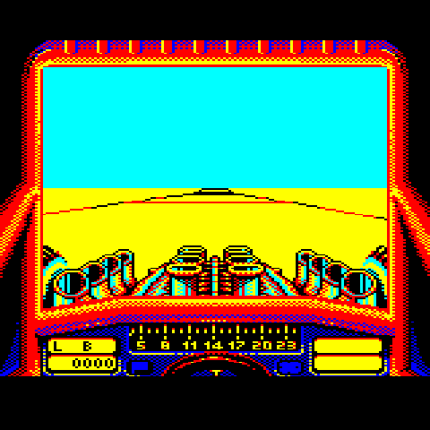
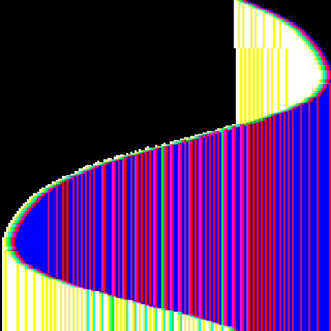
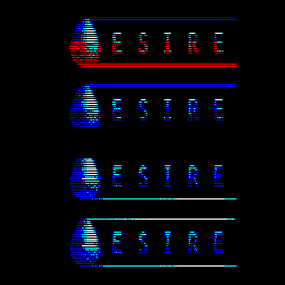
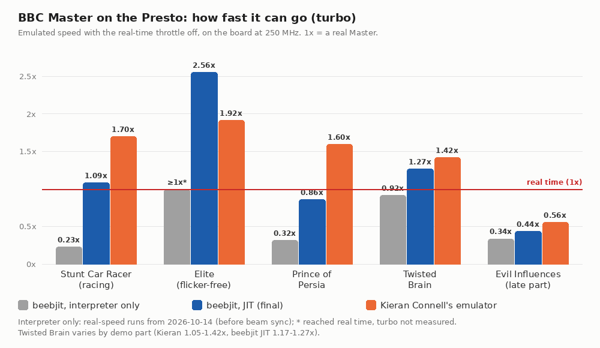

# BBC Master 128 on the Pimoroni Presto

A BBC Master 128 on a [Pimoroni Presto](https://shop.pimoroni.com/products/presto): one RP2350
(two Cortex-M33 cores at 250 MHz, 520 KB of SRAM, 8 MB of PSRAM) behind a 480×480 panel. It runs
the hardest Master games and demos we could find, standalone: power on and it boots the disc
built into the firmware.

The emulator is [Kieran Connell's ground-up emulator](https://github.com/kieranhj/esp32-beeb):
a cycle-stepped 65C12 and BBC Master 128 written from scratch for small microcontrollers, and
checked frame by frame against [beebjit](https://github.com/scarybeasts/beebjit). This branch
puts it on the Presto. (The `main` branch is the BBC Model B, on beebjit; the end of this
README explains why the Master went another way.)

## Where it got to

All captured on the Presto, from the panel itself (`tools/presto.py shot`):

| | | |
|---|---|---|
|  |  |  |
| Stunt Car Racer, racing | Elite (flicker-free, Master) | Prince of Persia |
|  |  | |
| Twisted Brain | Evil Influences, late part | |

On the board at 250 MHz. Speed is against a real Master: 100.0% is real time. Turbo is the
same run with the throttle off, so it shows how much headroom is left.

| Disc | What makes it hard | Speed | Turbo | Core 0 / core 1 at real speed |
|---|---|---|---|---|
| Stunt Car Racer, racing | 3D, sideways-RAM bank calls thousands of times a second | 100% | 1.70× | 57% / 37% |
| Elite (flicker-free, Master) | shadow RAM switched around every line it plots | 100% | 1.92× | 50% / 42% |
| Prince of Persia | big sideways-RAM game, display tricks through the CRTC | 100% | 1.60× | 61% / 39% |
| Twisted Brain (demo) | per-scanline raster effects | 100% | 1.05–1.42× (varies by part) | 65% / 42% |
| Evil Influences (demo), late part | ~1,000 CRTC writes a frame | **56%** | — | 98% / 76% |

- **Four of the five run in real time with room to spare.** The fifth, the late part of Evil
  Influences, reprograms the 6845 CRTC about a thousand times a frame in mini-frames a few
  scanlines tall. It runs at 56% of real speed here. The emulator doesn't keep up there on the hardware it
  was written for either.
- **About 160 KB of the 520 KB of SRAM is free.** That's room for sound, a disc menu, or an SD
  card, without taking anything out.

## How it runs on the Presto

- **Core 0 runs the machine**: Kieran's 65C12, VIAs, CRTC, 1770 floppy controller and Master
  paging, from SRAM, paced to real time. As it runs, it writes a stream of what the CRTC fetches,
  one 16-bit word a character, into a 16 KB ring.
- **Core 1 renders that stream**, with Kieran's renderer (bitmap modes, teletext, mid-line palette
  and mode changes), straight into the panel's rows: one row per scanline, 4 bits a pixel,
  640 pixels to 480.
- **PIO and DMA scan the rows out** to the ST7701 panel, stretching 256 rows to 480 for free.
- **Memory:** the hot code, the CPU's tables, MOS and DFS in SRAM. The other ROMs, sideways RAM
  and the disc's track data in PSRAM. The disc image itself in flash.

`core/` is Kieran's core, unmodified, from
[his commit ca72230](https://github.com/kieranhj/esp32-beeb/tree/ca72230). `presto/` is the port:
`main.c` (pacing, USB, stats), `machine_unit.c` and `render_unit.c` (the two halves, built to
run from SRAM), and the panel and PSRAM drivers.

## Build and flash

```
scripts/setup.sh                      # toolchain, Pico SDK, ROMs, discs; builds with Elite
scripts/setup.sh --disc=pop-beeb.ssd  # or another disc in discs/
```

It fetches the pinned Arm toolchain and Pico SDK into `deps/`, the MOS 3.20 ROMs (from beebjit's
ROM set) into `roms/`, and the five discs above into `discs/`. None of them are in this
repository. Then hold BOOT and tap RESET on the Presto, and copy `build/presto_master.uf2` to
the RP2350 drive (or add `--flash`). After that, `python3 tools/presto.py bootsel` gets to the
bootloader without the buttons.

To rebuild by hand: `. deps/env.sh`, then
`cmake -S . -B build -G Ninja -DBEEB_DISC=discs/<disc>.ssd && ninja -C build`.

## Measuring

`tools/presto.py` talks to the firmware over USB serial: `stats` (speed and both cores' load,
every 250 frames), `turbo`, `shot out.png`, `key <scancode> [ms]`, `bootsel`. The figures above
come from one run per disc. SPACE, SPACE, RETURN at 43, 49 and 55 s after flashing get each game
going; Stunt Car Racer takes five more RETURNs (Practise, Division 4, the Little Ramp, start)
to reach the track. Speed is read at 100 s (135 s for Stunt Car), turbo 20 s later.

## History: beebjit on the Master first

The Model B on `main` runs [beebjit](https://github.com/scarybeasts/beebjit), Chris Evans'
accurate emulator with a JIT. On the Presto the JIT compiles 6502 code into Thumb-2 and runs
Elite at nine to ten times real speed. So the Master started there too: same firmware, with
beebjit's Master 128 model switched on. It got a long way, and it stayed frame-exact against
beebjit's interpreter throughout. It found and fixed four accuracy bugs along the way, one of
them in upstream beebjit (decimal mode after SED/PLP in a JIT block).


(Earlier stats truncated to whole percent, so real time often read 99%; it's shown as 100% here.)

- **First board runs: 5% and 6%.** The Master pages memory all the time: shadow screen RAM
  (Elite switches it around every line it plots, about 430 times a second), sideways ROM and
  RAM banks (Stunt Car Racer calls into other banks about 5,700 times a second in its menus),
  ANDY and HAZEL. On a PC beebjit remaps pages with the MMU. The RP2350 has none, so every
  switch copied 16–20 KB through PSRAM and threw away the JIT code for that range.
- **Lazy paging windows took Stunt Car and Elite to real speed.** A short switch doesn't copy
  at all: the interpreter runs it through a small redirect table, and only a long one pages for
  real. But that means much of the Master's code now runs in the interpreter. On the Master the
  JIT's own code was 2–4% of core 0's time.
- **Video fast paths and beam-synced screen memory took PoP to 80% and Evil to 45%.** Beam sync
  also made it more accurate: each screen byte is now read at its beam position, as Kieran's
  emulator does (its write window was the model).
- **Then the gains ran out.** What was left was the cost of moving in and out of the JIT,
  interpreter callbacks, and video timing on core 0. The beebjit Master build had 29 KB of
  SRAM free, so every further speed-up had to take something else out first.

Kieran's emulator, ported in an afternoon, was faster on four of the five discs straight away,
with five times the free SRAM. Flat out (turbo), with the line at real time:



| Disc | beebjit Master: speed / turbo | Kieran Connell's emulator: speed / turbo |
|---|---|---|
| Stunt Car Racer, racing | 100% / 1.09× | 100% / **1.70×** |
| Elite | 100% / **2.56×** | 100% / 1.92× |
| Prince of Persia | 80% / 0.86× | **100% / 1.60×** |
| Twisted Brain | 100% / 1.17–1.27× | 100% / **1.05–1.42×** |
| Evil Influences, late part | 44% | **56%** |
| SRAM free | 29 KB | **~160 KB** |

**Why we stopped:** the JIT pays off when a program runs the same code for a long time in
memory that stays put. That's most Model B software, which is why `main` stays on beebjit. Master
software pages too often, and the Presto has no MMU to make paging cheap. So beebjit's Master
ended up as an interpreter with a JIT attached, short of real time on PoP and Evil, and out of
SRAM. Kieran's emulator was designed for this class of chip from the start: no JIT, a cycle-stepped
CPU tuned to its budget, and video split across two cores. It does the Master better here, and
leaves room for the next things (sound first).

## Credits

- [Kieran Connell](https://github.com/kieranhj/esp32-beeb): the emulator in `core/`.
- [beebjit](https://github.com/scarybeasts/beebjit) by Chris Evans: the reference Kieran's
  emulator is checked against, and the MOS 3.20 ROM set `setup.sh` fetches (Acorn's ROMs; not
  covered by this licence).
- The teletext character set in `core/teletext_glyphs.h` is from
  [B-em](https://github.com/stardot/b-em) by Sarah Walker and others.
- The panel driver is adapted from Pimoroni's MIT-licensed
  [Presto ST7701 driver](https://github.com/pimoroni/presto).
- The discs: [bitshifters](https://bitshifters.github.io/) (Prince of Persia, Stunt Car Racer,
  Twisted Brain, Evil Influences) and Mark Moxon's
  [flicker-free Elite](https://elite.bbcelite.com/) for the Master. Fetched by `setup.sh`, not
  in this repository.

## Licence

GPL-3.0, as Kieran's emulator; see [`LICENSE`](LICENSE). ROM and disc images are not part of
this repository and are not covered by it.
