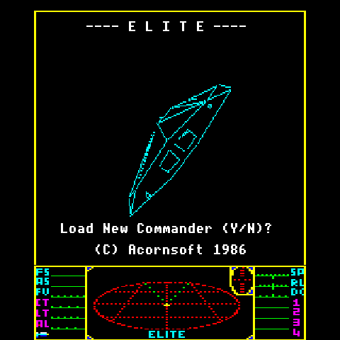
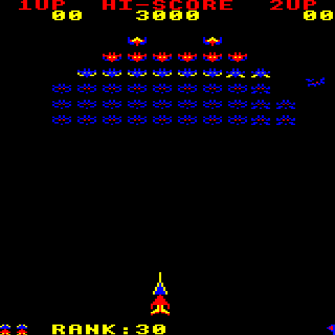
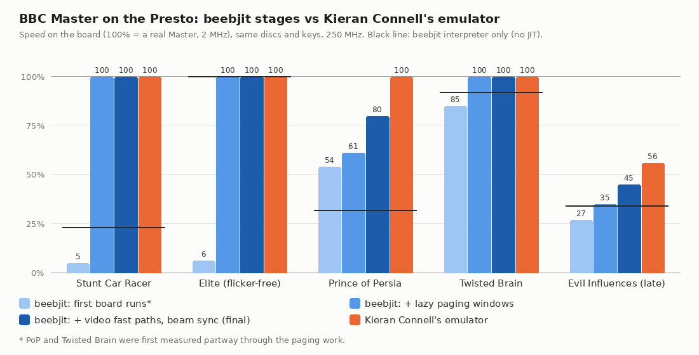
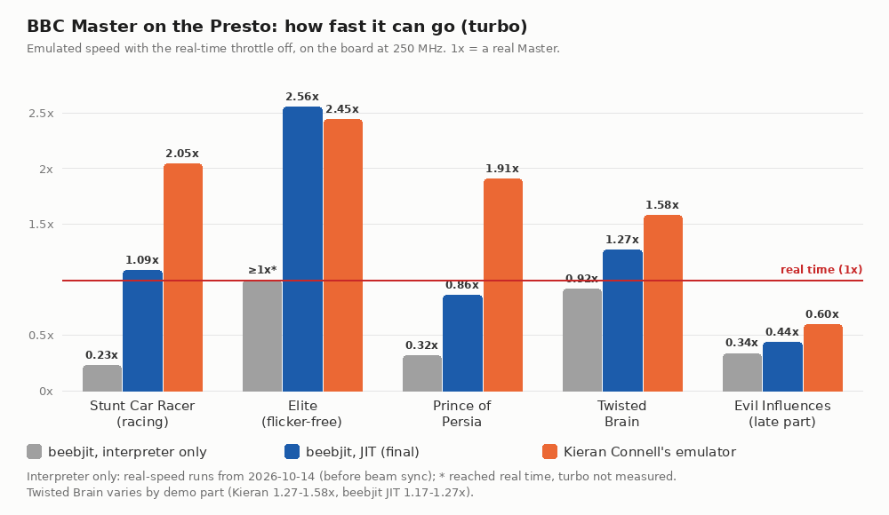

# BBC Master 128 on the Pimoroni Presto

(`-DMACHINE=master`, or `scripts/setup.sh --master`; this page was the `bbc-master`
branch's README, merged here with its history.)

A BBC Master 128 on a [Pimoroni Presto](https://shop.pimoroni.com/products/presto): one RP2350
(two Cortex-M33 cores at 250 MHz, 520 KB of SRAM, 8 MB of PSRAM) behind a 480×480 panel. It runs
the hardest Master games and demos we could find, standalone: power on and it boots the disc
built into the firmware.

The emulator is [Kieran Connell's ground-up emulator](https://github.com/kieranhj/esp32-beeb):
a cycle-stepped 65C12 and BBC Master 128 written from scratch for small microcontrollers, and
checked frame by frame against [beebjit](https://github.com/scarybeasts/beebjit). This build
puts it on the Presto. (The default build is the BBC Model B, on beebjit; the end of this
page explains why the Master went another way.)

## Where it got to

All captured on the Presto, from the panel itself (`tools/presto.py shot`):

| | | |
|---|---|---|
|  |  |  |
| Stunt Car Racer, racing | Elite (flicker-free, Master), title | Prince of Persia |
|  |  |  |
| Twisted Brain | Evil Influences, late part | Arcadians, in play |

On the board at 250 MHz. Speed is against a real Master: 100.0% is real time. Turbo is the
same run with the throttle off, so it shows how much headroom is left.

| Disc | What makes it hard | Speed | Turbo | Core 0 / core 1 at real speed |
|---|---|---|---|---|
| Stunt Car Racer, racing | 3D, sideways-RAM bank calls thousands of times a second | 100% | 2.05× | 47% / 32% |
| Elite (flicker-free, Master) | shadow RAM switched around every line it plots | 100% | 2.45× | 38% / 32% |
| Prince of Persia | big sideways-RAM game, display tricks through the CRTC | 100% | 1.91× | 50% / 33% |
| Twisted Brain (demo) | per-scanline raster effects | 100% | 1.27–1.58× (varies by part) | 54% / 34% |
| Evil Influences (demo), late part | ~1,000 CRTC writes a frame | **100%** (was 60%) | — | 81% / 61% |
| Arcadians | software sprites: the convoy, divers, shots, all drawn by the CPU | 100% | 2.39× | 43% / 45% |

- **All six run in real time.** The late part of Evil Influences reprograms the 6845 CRTC about
  a thousand times a frame, in mini-frames a few scanlines tall. It ran at 60% until Kieran's later
  work on his core for exactly this demo was brought in (below). Now every 5 s of its 370 s runs
  at 100%, with core 0 at most 81% busy.
- **About 115 KB of the 520 KB of SRAM is still free** with WiFi and the web panel running (below),
  and they cost no measurable speed.

## How it runs on the Presto

- **Core 0 runs the machine**: Kieran's 65C12, VIAs, CRTC, 1770 floppy controller and Master
  paging, from SRAM, paced to real time. As it runs, it writes a stream of what the CRTC fetches,
  one 16-bit word a character, into a 16 KB ring.
- **Core 1 renders that stream**, with Kieran's renderer (bitmap modes, teletext, mid-line palette
  and mode changes), straight into the panel's rows: one row per scanline, 4 bits a pixel,
  640 pixels to 480.
- **PIO and DMA scan the rows out** to the ST7701 panel, stretching 256 rows to 480 for free.
- **Memory:** the hot code, the CPU's tables, MOS and DFS in SRAM. The other ROMs, sideways RAM
  and the disc's track data in PSRAM. The disc image itself in flash.

`src/cores/kc-beeb/` is Kieran's core from [his commit ca72230](https://github.com/kieranhj/esp32-beeb/tree/ca72230),
with three changes for speed, each checked to give identical pictures on all five discs (and,
since, analogue inputs and saved games: `src/cores/kc-beeb/UPSTREAM` lists them all):

- **A hang after 35.8 minutes fixed.** Two places counted the VIAs' 1 MHz ticks by shifting the
  absolute cycle count, which went wrong when the 32-bit count wrapped at 2^32 cycles. They now
  count from the chunk length. (`machine.c`)
- **The CPU's registers and flags kept as 32-bit fields.** Byte-sized fields cost the M33 a
  bit-field insert at every write. This took core 0's load at real speed down by about 10 points
  on every disc, and turbo up by about a fifth. (`cpu6502.h`, `cpu6502.c`)
- **Two pixel tables of each kind kept.** On the board the tables depend on the screen mode alone;
  Elite's MODE 4 top and MODE 5 dashboard rebuilt a 4 KB table twice a frame. (`render.c`,
  `render.h`; 6 KB more SRAM)

**Evil Influences at real speed (Kieran's later commits).** Kieran's upstream went on from
ca72230 with nine commits on this demo (its RVI part: R0 = 1 two-character lines, R0, R9, R12
and R13 rewritten every scanline, and palette writes between them). They are merged into
`src/cores/kc-beeb/` as they are, and `UPSTREAM` lists them. There are two small changes, both so that
`struct machine` keeps its layout and size, and states saved from it still load. The hot spot was
the machine's catch-ups. The CRTC's vsync bound stopped the whole machine at every CRTC line end in
case a vsync started there, and with R0 = 1 a line ends every 2 ticks. On the host, 1,000 frames of
the late part took 4.6 million machine catch-ups (one every 9 emulated cycles) and 4.8 million exact
CRTC ticks. The core 0 cost came to about 2,000 clocks a CRTC write. Upstream bounds it by the line
ends to R7 instead. Short lines run in their own loops (`crtc_short_lines`, and `crtc_short_block`
for R0 = 1). CRTC register, paging and display writes take the quiet window. The display write
window counts rows. The renderer's run loops take DISPEN changes and row address events in passing. After this, the
same 1,000 frames take 32 thousand catch-ups and 0.7 million exact ticks.

Checked on the host, with the board's renderer settings, against the build before. Every rendered
frame is identical over all of Evil Influences (19,000 frames), and so is the video stream (in a
form that ignores how runs are split). Every rendered frame is also identical over 8,000 frames of
each other disc. The stream differs only on Twisted Brain and Arcadians, and only where a display
store races the beam on a byte that is not shown. With fewer machine catch-ups, the CRTC follows the
"the fetches since the last store see it" model (beebjit's) more closely.

On the board, the same build of main before and after, same scenes, core 0 / core 1:

| Disc | Before | After |
|---|---|---|
| Evil Influences, late part (80-115 s) | 60% speed, 97–98% / 49% | 100%, 80–81% / 61% |
| Evil Influences, other heavy parts (120-370 s) | 60–66% speed, 97–98% / 44–49% | 100%, 68–79% / 51–60% |
| Stunt Car Racer (menus, 51–81 s) | 100%, 52–53% / 33% | 100%, 47–48% / 37% |
| Prince of Persia (100 s) | 100%, 50% / 33% | 100%, 46% / 38% |
| Twisted Brain (51–121 s) | 100%, 44–70% / 34–57% | 100%, 39–71% / 38–60% |
| Elite (title, 100 s) | 100%, 38% / 32% (table above) | 100%, 34% / 35% |
| Arcadians (in play, 70 s) | 100%, 43% / 45% (table above) | 100%, 37% / 33% |

Core 0 is 3–5 points lower everywhere. Core 1 is 2–5 points higher on the other discs, from the
renderer's wider run loops. The rest of the table above is from before this merge.

`src/machines/master/` is the port: `main.c` (pacing, keys, stats), `master_machine.c` (drive 0,
resets), `machine_unit.c` and `render_unit.c` (the two halves, built to run from SRAM); the panel,
PSRAM, SD card, WiFi and web page are the board's and the common code's, shared with the Model B
(`src/boards/presto/`, `src/common/`). `render_unit.c` packs the
renderer's lines into the panel's 4-bit rows 32 pixels at a time (part lines too, which Evil
Influences' raster section is made of) and hands the renderer the whole backlog at once; with the
tables above, core 1's load at real speed went from 37–42% to 32–34%, and from 80% to 49% on
Evil.

## Build and flash

```
scripts/setup.sh --master                      # toolchain, Pico SDK, MOS 3.20 ROMs, discs; builds with Elite
scripts/setup.sh --master --disc=pop-beeb.ssd  # or another disc in discs/
```

It fetches the pinned Arm toolchain and Pico SDK into `deps/`, the MOS 3.20 ROMs (from beebjit's
ROM set) into `roms/mos3.20/`, and the six discs above into `discs/`. None of them are in this
repository. Then hold BOOT and tap RESET on the Presto, and copy `build-master/presto_master.uf2` to
the RP2350 drive (or add `--flash`). After that, `python3 tools/presto.py bootsel` gets to the
bootloader without the buttons.

To rebuild by hand: `. deps/env.sh`, then
`cmake -S . -B build-master -G Ninja -DMACHINE=master -DBEEB_DISC=$PWD/discs/<disc>.ssd && ninja -C build-master`.
(Without `-DMACHINE=master` the same tree builds the Model B.)

## Web panel

Give the Presto your WiFi network once over USB (a Pimoroni-style `secrets.py` with `WIFI_SSID`
and `WIFI_PASSWORD`), and it restarts and joins it:

```
python3 tools/presto.py wifi secrets.py
```

Then open **http://presto-xxxx.local/** (the Presto's own name, which its screen shows at power on; or its address, from `python3 tools/presto.py net`). The panel
has a BBC keyboard (or uses your own keyboard's keys, by position), BREAK and SHIFT+BREAK, turbo,
the speed and both cores' load, and loading discs: drop or choose a `.ssd`, `.dsd` or `.zip`, give
it a link to one, or pick one from the SD card. A disc boots at once (a reset with SHIFT held);
"Eject" goes back to the one built into the firmware. Behind it is a small JSON API
(`/api/status`, `/api/keys`, `/api/disc`, `/api/eject`, ...; see `src/common/api/api.c`; `tools/presto.py` has the same commands over USB).

The network is polled on core 0 in the gaps between the machine's runs, and requests act between
frames, so nothing races the emulation. Over USB the same things are `presto.py discs`, `disc`
and `put`. One difference from a real Master: BREAK is a power-on reset (the core has no warm
reset), so a BASIC program in memory does not survive it.

## Saved games

Games can save to the disc built into the firmware, and what they save survives a power-off. The
built-in image stays as it came (the golden disc); a full copy of it, the save disc, lives in
flash. At boot the save disc goes into the drive if there is one for this golden disc. When a
game writes to the disc, a second after the drive goes quiet the tracks it wrote are read back
and only the flash blocks that changed are rewritten (an Elite save: one or two). Nothing else
writes flash. **Restore original disc** on the web panel (or `!restore` over USB) forgets
the save disc and boots the golden one. (This is `src/common/drive.c` now, and the Model B has it
too.) Discs loaded from the card or the web keep their writes
for the session only.

## A program alongside the machine

`src/common/machine_hook.h` is a small, versioned interface for a program built into the firmware that
watches the machine and presses keys (the [Elite agent](https://github.com/8bitkick/elite-agent)
is one). Once per emulated frame, between frames, it gets the machine model and MOS version,
where the Master's RAM is (main, shadow, ANDY, HAZEL), a key function for the keyboard matrix
and a reset count; commands the platform doesn't know (USB `!...` or `POST /api/command`) go to
it; `GET /api/program` shows its own panel on the web page; and it can give the loading screen
its own picture. All of it is weak, doing nothing unless a build supplies it: build one in with
`-DMACHINE_EXTRA_SOURCES=...` (and `_INCLUDES`, `_DEFINES`).

A loading screen shows while the ROMs and the disc go into PSRAM, with how far they've got; a
program can supply its picture.

## Measuring

`tools/presto.py` talks to the firmware over USB serial: `stats` (speed and both cores' load,
every 250 frames), `turbo`, `shot out.png`, `key <scancode> [ms]`, `bootsel`. The figures above
come from one run per disc. SPACE, SPACE, RETURN at 43, 49 and 55 s after flashing get each game
going; Stunt Car Racer takes five more RETURNs (Practise, Division 4, the Little Ramp, start)
to reach the track. Arcadians takes SPACE at 31 and 41 s and 1 at 57 s (its two instruction pages,
then a one-player game), and is measured at 70 s, turbo at 80 s, while the game is still on. Speed is read at 100 s (135 s for Stunt Car), turbo 20 s later.

## History: beebjit on the Master first

The Model B (the default build) runs [beebjit](https://github.com/scarybeasts/beebjit), Chris Evans'
accurate emulator with a JIT. On the Presto the JIT compiles 6502 code into Thumb-2 and runs
Elite at nine to ten times real speed. So the Master started there too: same firmware, with
beebjit's Master 128 model switched on. It got a long way, and it stayed frame-exact against
beebjit's interpreter throughout. It found and fixed four accuracy bugs along the way, one of
them in upstream beebjit (decimal mode after SED/PLP in a JIT block).



(Earlier stats truncated to whole percent, so real time often read 99%; it's shown as 100% here.)

- **First board runs: 5% and 6%.** The Master pages memory all the time: shadow screen RAM
  (Elite switches it around every line it plots, about 430 times a second), sideways ROM and
  RAM banks (Stunt Car Racer calls into other banks about 5,700 times a second in its menus),
  ANDY and HAZEL. On a PC beebjit remaps pages with the MMU. The RP2350 has none, so every
  switch copied 16–20 KB through PSRAM and threw away the JIT code for that range.
- **Lazy paging windows took Stunt Car and Elite to real speed.** A short switch doesn't copy
  at all: the interpreter runs it through a small redirect table, and only a long one pages for
  real. But that means much of the Master's code now runs in the interpreter. On the Master the
  JIT's own code was 2–4% of core 0's time.
- **Video fast paths and beam-synced screen memory took PoP to 80% and Evil to 45%.** Beam sync
  also made it more accurate: each screen byte is now read at its beam position, as Kieran's
  emulator does (its write window was the model).
- **Then the gains ran out.** What was left was the cost of moving in and out of the JIT,
  interpreter callbacks, and video timing on core 0. The beebjit Master build had 29 KB of
  SRAM free, so every further speed-up had to take something else out first.

Kieran's emulator, ported in an afternoon and still unmodified, was faster on four of the five
discs straight away, with five times the free SRAM:

| Disc | beebjit Master: speed / turbo | Kieran Connell's emulator as first ported: speed / turbo |
|---|---|---|
| Stunt Car Racer, racing | 100% / 1.09× | 100% / **1.70×** |
| Elite | 100% / **2.56×** | 100% / 1.92× |
| Prince of Persia | 80% / 0.86× | **100% / 1.60×** |
| Twisted Brain | 100% / 1.17–1.27× | 100% / **1.05–1.42×** |
| Evil Influences, late part | 44% | **56%** |
| SRAM free | 29 KB | **~160 KB** |

Flat out (turbo) as it is now, with the two changes above, against beebjit (the line is real
time):



**Why we stopped:** the JIT pays off when a program runs the same code for a long time in
memory that stays put. That's most Model B software, which is why the Model B stays on beebjit. Master
software pages too often, and the Presto has no MMU to make paging cheap. So beebjit's Master
ended up as an interpreter with a JIT attached, short of real time on PoP and Evil, and out of
SRAM. Kieran's emulator was designed for this class of chip from the start: no JIT, a cycle-stepped
CPU tuned to its budget, and video split across two cores. It does the Master better here, and
leaves room for the next things: sound (`-DSOUND=ON`) and the LEDs on the back (`-DAMBIENT=ON`),
on core 1, cost it about 3 points of core 1 (docs/cores.md).

## Credits

- [Kieran Connell](https://github.com/kieranhj/esp32-beeb): the emulator in `src/cores/kc-beeb/`.
- [beebjit](https://github.com/scarybeasts/beebjit) by Chris Evans: the reference Kieran's
  emulator is checked against, and the MOS 3.20 ROM set `setup.sh` fetches (Acorn's ROMs; not
  covered by this licence).
- The teletext character set in `src/cores/kc-beeb/teletext_glyphs.h` is from
  [B-em](https://github.com/stardot/b-em) by Sarah Walker and others.
- The web keyboard's keycaps use [Open Gorton](https://github.com/dakotafelder/open-gorton) by Dakota
  Felder (MIT, `src/common/api/web/fonts`), after the Gorton Modified engraving on the real keys.
- The SD card's file system is ChaN's [FatFs](http://elm-chan.org/fsw/ff/) (`src/boards/presto/fatfs`, its
  own licence); the network is the Pico SDK's lwIP and CYW43 driver.
- The panel driver is adapted from Pimoroni's MIT-licensed
  [Presto ST7701 driver](https://github.com/pimoroni/presto).
- The discs: [bitshifters](https://bitshifters.github.io/) (Prince of Persia, Stunt Car Racer,
  Twisted Brain, Evil Influences) and Mark Moxon's
  [flicker-free Elite](https://elite.bbcelite.com/) for the Master. Fetched by `setup.sh`, not
  in this repository.

## Licence

GPL-3.0, as Kieran's emulator; see [`LICENSE`](../../LICENSE). ROM and disc images are not part of
this repository and are not covered by it.
